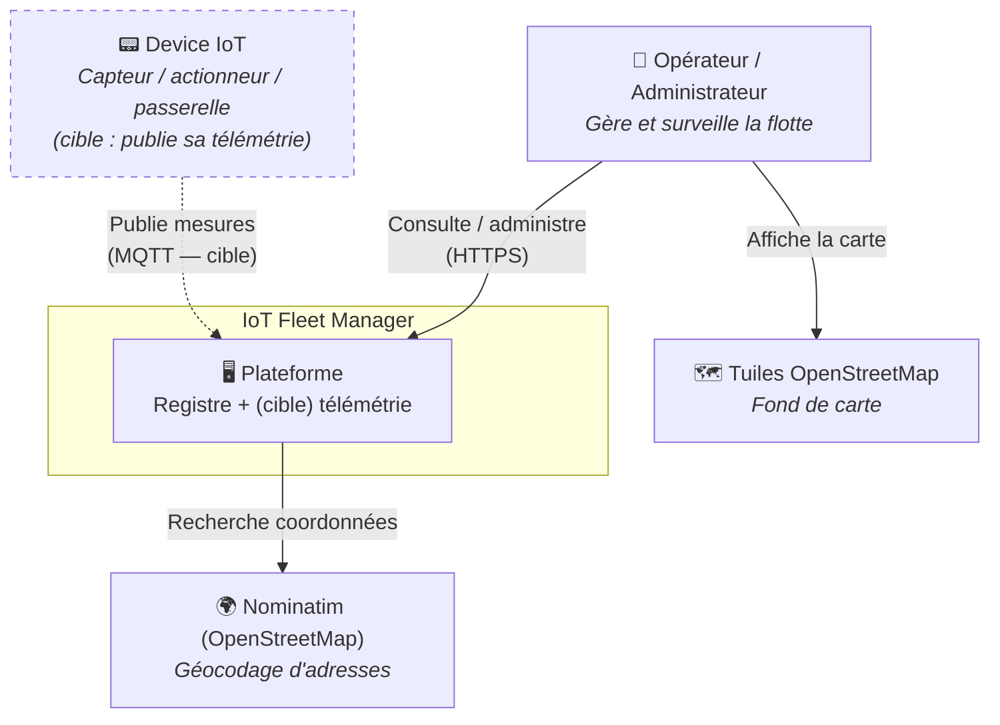
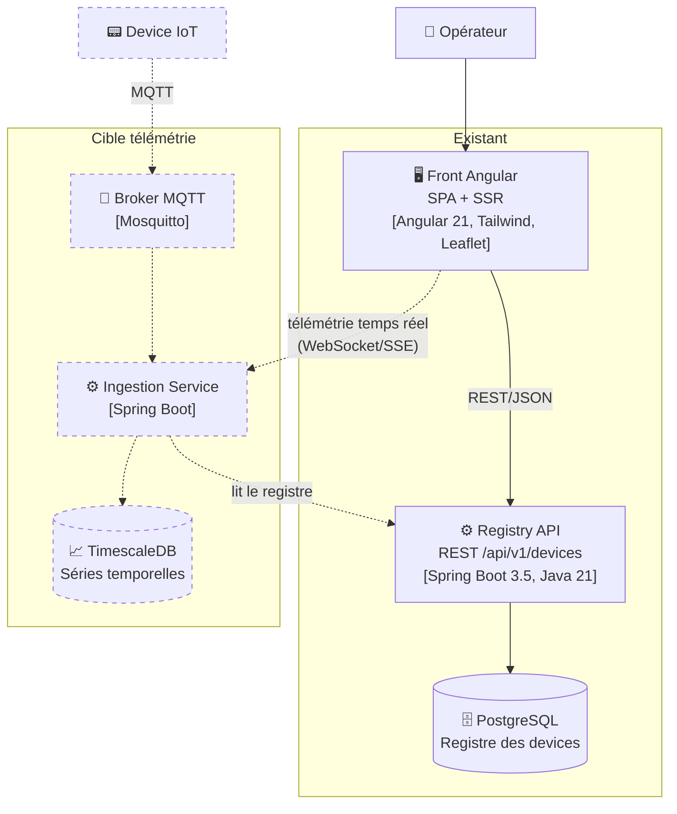
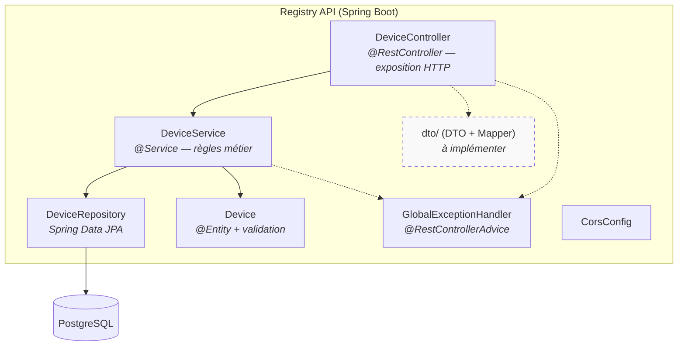
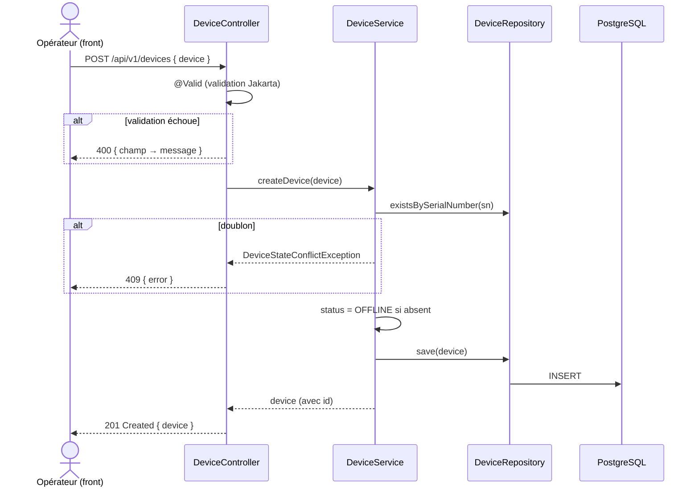
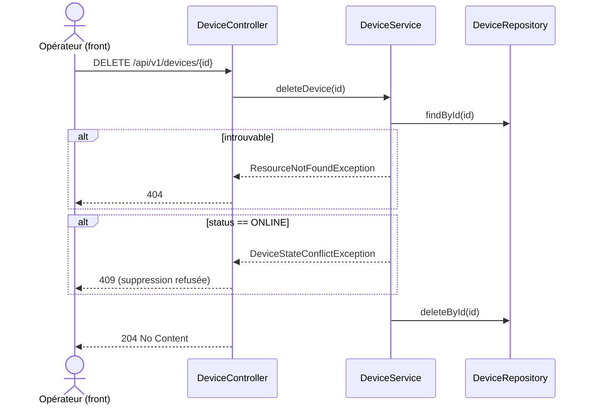
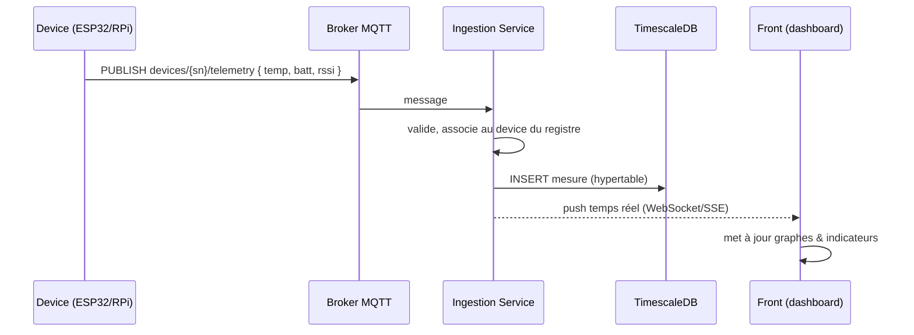
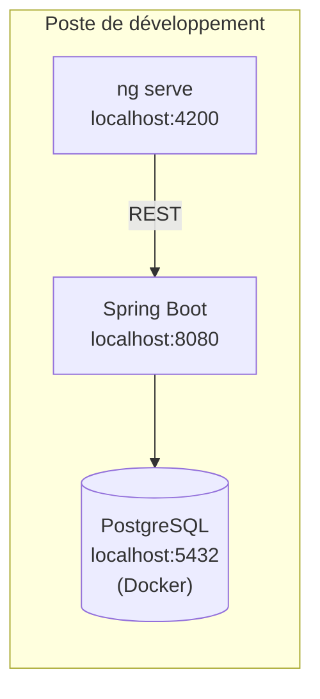
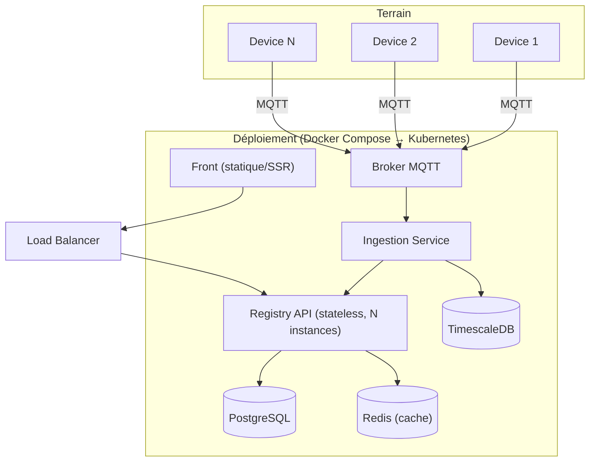

# IoT Fleet Manager — Dossier d'architecture

> Document d'architecture logicielle, structuré selon le canevas **arc42**.
> Il décrit **l'état actuel** du système (registre de flotte + interface Angular) et **l'architecture cible** (plateforme IoT avec ingestion de télémétrie temps réel).
> Les diagrammes suivent le **modèle C4**. Les décisions structurantes sont consignées comme **ADR** dans [`adr/`](./adr/).

| | |
|---|---|
| **Projet** | IoT Fleet Manager |
| **Version du document** | 1.0 |
| **Statut** | Vivant — mis à jour à chaque phase |
| **Dépôts** | `iot-fleet-manager` (backend), `iot-fleet-manager-front` (front) |
| **Auteur** | Aymen El Ktini |

---

## 1. Objectifs et périmètre (Introduction and Goals)

### 1.1 Vue d'ensemble

IoT Fleet Manager est une plateforme de **gestion d'une flotte d'équipements connectés** (capteurs, actionneurs, passerelles) déployés sur le terrain. Elle vise deux missions complémentaires :

1. **Le registre de flotte** — connaître à tout instant l'inventaire des équipements, leur identité, leur type, leur position géographique et leur statut opérationnel. *(Implémenté aujourd'hui.)*
2. **La télémétrie** — recevoir en continu les mesures remontées par ces équipements (température, batterie, qualité de signal…), les stocker, les visualiser et déclencher des alertes. *(Cible — non encore implémenté.)*

> **Note de périmètre honnête.** À la date de ce document, seul le registre existe. Il n'y a **aucune ingestion de données** (pas de broker, pas de série temporelle). Le système actuel est donc un **registre de devices** exposé en REST, consommé par une interface web — pas encore une plateforme de télémétrie. Cette distinction est assumée et structure toute la roadmap (§ 9).

### 1.2 Objectifs principaux

| # | Objectif | Description |
|---|----------|-------------|
| G1 | Gérer le cycle de vie d'un device | Enregistrement, consultation, mise à jour, retrait — avec des règles métier garantissant l'intégrité opérationnelle. |
| G2 | Offrir une vue d'ensemble de la flotte | Interface web listant les devices, leur statut, et les localisant sur une carte. |
| G3 | Ingérer la télémétrie à grande échelle *(cible)* | Absorber un flux massif de mesures depuis des milliers de devices, les stocker et les restituer. |
| G4 | Alerter *(cible)* | Détecter et notifier les anomalies (seuils, silence prolongé d'un device). |
| G5 | Être exploitable en production | Observabilité, sécurité, déploiement reproductible. |

### 1.3 Exigences qualité prioritaires

Voir § 10 pour le détail. Par ordre de priorité : **maintenabilité**, **testabilité**, **scalabilité** (surtout pour la télémétrie), **sécurité**, **observabilité**.

### 1.4 Parties prenantes

| Rôle | Attentes |
|------|----------|
| **Opérateur de flotte** | Consulter l'état des devices, les localiser, réagir aux alertes. |
| **Administrateur** | Enregistrer, mettre à jour, retirer des devices ; gérer les droits. |
| **Développeur / mainteneur** | Code lisible, testable, faiblement couplé ; documentation à jour. |
| **Device sur le terrain** *(cible)* | Publier sa télémétrie de façon fiable, sur réseau instable. |

---

## 2. Contraintes (Constraints)

### 2.1 Contraintes techniques

| Contrainte | Détail |
|------------|--------|
| Langage backend | **Java 21** (LTS). |
| Framework backend | **Spring Boot 3.5**. |
| Base de données (registre) | **PostgreSQL**. |
| Framework front | **Angular 21** (standalone components, SSR + hydration). |
| Communication front/back | **REST/JSON** sur HTTP. |
| Build | **Maven** (backend), **Angular CLI / esbuild** (front). |

### 2.2 Contraintes d'organisation

- Projet **personnel**, développé en solo, à vocation d'apprentissage **et** de déploiement réel avec du vrai matériel (ESP32, Raspberry Pi).
- Livraison **incrémentale par phases** (§ 9) ; chaque phase doit produire quelque chose qui tourne.
- Le code d'architecture (décisions) vit dans le dépôt (ADR) ; le suivi d'avancement vit sur Notion.

### 2.3 Conventions

- Architecture **en couches** ; séparation stricte des responsabilités (voir ADR-0002).
- **Injection par constructeur** exclusivement, champs `final`.
- Gestion d'erreurs **centralisée** via `@RestControllerAdvice`.
- Nommage des endpoints versionné : `/api/v1/...`.

---

## 3. Contexte du système (Context and Scope)

### 3.1 Contexte métier — Diagramme C4 niveau 1 (System Context)

**Légende** : les flèches en pointillés et les mentions *(cible)* désignent ce qui n'est pas encore implémenté.

### 3.2 Interfaces externes

| Interface | Nature | Direction | Statut |
|-----------|--------|-----------|--------|
| API REST `/api/v1/devices` | HTTP/JSON | Front → Backend | ✅ Existant |
| Nominatim (`nominatim.openstreetmap.org`) | HTTP/JSON | Front → externe | ✅ Existant |
| Tuiles OSM (`tile.openstreetmap.org`) | HTTP | Front → externe | ✅ Existant |
| Broker MQTT | MQTT | Device → Backend | 🎯 Cible |

> **Note.** Le géocodage et les tuiles sont appelés **directement par le navigateur**, pas par le backend. Le backend n'a aujourd'hui **aucun appel sortant**.

---

## 4. Stratégie de solution (Solution Strategy)

| Enjeu | Décision | ADR |
|-------|----------|-----|
| Organisation du code | Architecture **en couches** (controller / service / repository / model), monolithe modulaire. | [ADR-0002](./adr/0002-architecture-en-couches.md) |
| Persistance du registre | **PostgreSQL** via Spring Data JPA (données relationnelles, contrainte d'unicité forte). | [ADR-0003](./adr/0003-postgresql-pour-le-registre.md) |
| Contrat d'API | Migration de « l'entité exposée directement » vers des **DTO** dédiés par opération. | [ADR-0004](./adr/0004-dto-et-mapper.md) |
| Typage du domaine | Remplacer les `String` + regex par des **enums** (`DeviceType`, `DeviceStatus`). | [ADR-0005](./adr/0005-enums-pour-type-et-statut.md) |
| Concurrence | **Transactions** explicites + **verrou optimiste** (`@Version`). | [ADR-0006](./adr/0006-transactions-et-verrou-optimiste.md) |
| Passage à l'échelle IoT | **Séparer** le registre (relationnel, cohérence forte) de l'**ingestion de télémétrie** (écritures massives, time-series). | [ADR-0007](./adr/0007-separer-registre-et-telemetrie.md) |
| Protocole de télémétrie | **MQTT** + broker (Mosquitto), Kafka en tampon si le débit le justifie. | [ADR-0008](./adr/0008-mqtt-pour-l-ingestion.md) |
| Stockage télémétrie | **TimescaleDB** (extension time-series de PostgreSQL). | [ADR-0009](./adr/0009-timescaledb-pour-la-telemetrie.md) |
| Sécurité | **JWT / Spring Security** — introduit après le câblage front/back de bout en bout. | [ADR-0010](./adr/0010-reporter-la-securite-jwt.md) |

---

## 5. Vue « blocs » (Building Block View)

### 5.1 Niveau 1 — Conteneurs (C4 niveau 2)

### 5.2 Niveau 2 — Composants de la Registry API (C4 niveau 3)

### 5.3 Description des blocs actuels

| Bloc | Responsabilité | Fichier |
|------|----------------|---------|
| `DeviceController` | Exposition HTTP des 6 endpoints, délégation au service, aucune logique métier. | `controller/DeviceController.java` |
| `DeviceService` | Règles métier : défaut de statut, refus des doublons, protection des devices ONLINE. | `service/DeviceService.java` |
| `DeviceRepository` | Persistance ; requêtes dérivées (`findBySerialNumber`, `existsBySerialNumber`). | `repository/DeviceRepository.java` |
| `Device` | Entité JPA + contraintes de validation Jakarta. | `model/Device.java` |
| `GlobalExceptionHandler` | Traduction centralisée exception métier → code HTTP (400/404/409). | `exception/GlobalExceptionHandler.java` |
| `CorsConfig` | Autorise l'origine `http://localhost:4200`. | `config/CorsConfig.java` |
| `dto/` | *(vide)* — emplacement prévu pour les DTO. | `dto/` |

### 5.4 Le modèle de données actuel

L'entité **`Device`** (unique entité du domaine) :

| Champ | Type | Contraintes | Notes |
|-------|------|-------------|-------|
| `id` | `Long` | `@Id`, auto-généré | Exposé et actuellement acceptable en entrée (à corriger via DTO). |
| `serialNumber` | `String` | `@NotBlank`, `@Pattern ^SN-[A-Z0-9\-]{3,15}$`, `unique` | Identifiant naturel de la flotte. |
| `name` | `String` | `@NotBlank`, 3–50 caractères | |
| `type` | `String` | `@Pattern (SENSOR\|ACTUATOR\|GATEWAY)` | 🎯 à passer en enum. |
| `status` | `String` | libre | ex. `ONLINE`, `OFFLINE`, `WARNING`. 🎯 à passer en enum. |
| `lastCommunication` | `LocalDateTime` | `@UpdateTimestamp` | Renseigné automatiquement à chaque `save`. |
| `latitude`, `longitude` | `Double` | — | Pour la carte ; **non modifiables** par le PUT actuel (trou fonctionnel). |

---

## 6. Vue d'exécution (Runtime View)

### 6.1 Création d'un device (POST)

> **Faiblesse connue (check-then-act).** Entre `existsBySerialNumber` et `save`, deux requêtes concurrentes peuvent passer. La contrainte `unique` en base préserve l'intégrité, mais l'exception résultante (`DataIntegrityViolationException`) **n'est pas gérée** aujourd'hui → le second appel renverrait un **500** au lieu d'un 409. Corrigé en Phase 0 (handler dédié). Voir [ADR-0006](./adr/0006-transactions-et-verrou-optimiste.md).

### 6.2 Suppression d'un device (DELETE)

> **Incohérence UX repérée.** Le front crée les nouveaux devices avec `status = ONLINE`. Or un device `ONLINE` **ne peut pas être supprimé** (règle métier). Conséquence : un device fraîchement créé via l'interface est immédiatement indésupprimable. À traiter (soit création en `OFFLINE`, soit transition d'état explicite avant suppression). Voir [ADR-0005](./adr/0005-enums-pour-type-et-statut.md) (machine à états).

### 6.3 Ingestion de télémétrie *(cible)*

---

## 7. Vue de déploiement (Deployment View)

### 7.1 Développement local (actuel)

Aujourd'hui : PostgreSQL en conteneur Docker, backend et front lancés séparément. **Cible Phase 0** : un `docker-compose` unique (backend + PostgreSQL) pour démarrer d'une commande.

### 7.2 Cible

> **Point clé de scalabilité.** La Registry API est **stateless** (aucun état en mémoire entre requêtes, tout est en base) → elle scale **horizontalement** derrière un load balancer sans session collante. Voir § 8.

---

## 8. Concepts transverses (Crosscutting Concepts)

### 8.1 Validation
Aujourd'hui portée par l'entité (`@NotBlank`, `@Pattern`, `@Size`), déclenchée par `@Valid` au niveau du controller. **Cible** : déplacer la validation sur les **DTO de requête**, pour différencier création et mise à jour (ADR-0004).

### 8.2 Gestion d'erreurs
Centralisée dans `GlobalExceptionHandler` (`@RestControllerAdvice`) : exceptions métier explicites → codes HTTP. Extension prévue : `DataIntegrityViolationException` → 409, `OptimisticLockException` → 409.

### 8.3 Persistance et concurrence
Spring Data JPA, `ddl-auto=update` (dev uniquement). **Cible** : **Flyway** + `ddl-auto=validate` (schéma versionné, ADR non listé mais couvert § 9), transactions `@Transactional`, verrou optimiste `@Version`.

### 8.4 Observabilité
- **Journalisation** : aujourd'hui **absente** (seul `show-sql` est actif, qui est un outil de dev). Cible : **SLF4J** avec niveaux cohérents (INFO métier, WARN conflits, DEBUG technique) et logs **structurés (JSON)** + identifiant de corrélation par requête.
- **Métriques / santé** : dépendance **Actuator présente mais non configurée**. Cible : endpoints health (liveness/readiness) + métriques Micrometer → Prometheus.

### 8.5 Sécurité
Aujourd'hui : **aucune** (tous les endpoints ouverts). Cible : Spring Security + **JWT**, autorisations par rôle (opérateur = lecture, administrateur = écriture/suppression). Secrets sortis du dépôt (variables d'environnement / gestionnaire de secrets). Voir ADR-0010.

### 8.6 Configuration
`application.properties` avec identifiants **en clair** (à corriger). Cible : profils Spring (`dev`, `prod`), variables d'environnement.

### 8.7 Testabilité
Injection par constructeur → services testables sans conteneur Spring. Aujourd'hui : **tests unitaires avec mocks** sur les 3 couches (~520 lignes, ratio tests/prod ≈ 2,5:1). Manque : tests d'intégration (`@WebMvcTest` pour les codes HTTP et la sérialisation, `@DataJpaTest` sur Testcontainers pour les requêtes).

---

## 9. Décisions d'architecture et roadmap

Les décisions structurantes sont détaillées dans les **ADR** ([`adr/`](./adr/)). La feuille de route incrémentale :

| Phase | Objectif | Contenu principal |
|-------|----------|-------------------|
| **0** | Solidifier le backend | Enums, DTO+mapper, `@Transactional`+`@Version`, handler doublon concurrent, pagination/Specifications, logging SLF4J, Flyway, secrets externalisés, Actuator, `docker-compose`. |
| **1** | Front de gestion | Refactor du composant monolithique, liste + CRUD + dashboard d'état de flotte. |
| **2** | Ingestion télémétrie | Broker Mosquitto, service d'ingestion, entité `Measurement`, TimescaleDB. |
| **3** | Temps réel | Push WebSocket/SSE vers le dashboard, graphes de télémétrie. |
| **4** | Alertes | Moteur de règles (seuils, silence device), événements de domaine, notifications. |
| **5** | Vrai matériel | Firmware/agent (ESP32, Raspberry Pi) publiant de la télémétrie réelle en MQTT. |

---

## 10. Exigences qualité (Quality Requirements)

### 10.1 Arbre qualité

| Attribut | Scénario | Cible |
|----------|----------|-------|
| **Maintenabilité** | Ajouter un nouveau type de device. | Sans modifier le service (Strategy + injection Spring). |
| **Testabilité** | Vérifier une règle métier. | Test unitaire sans contexte Spring, en millisecondes. |
| **Scalabilité** | 500 000 devices, télémétrie toutes les 10 s. | Registre stateless scalé horizontalement ; ingestion découplée sur MQTT/time-series. |
| **Fiabilité** | Écritures concurrentes sur le même device. | Pas de *lost update* (verrou optimiste). |
| **Sécurité** | Accès non authentifié. | Refusé (401) une fois le JWT en place. |
| **Observabilité** | Tracer un incident de bout en bout. | Logs structurés + identifiant de corrélation ; métriques exportées. |

### 10.2 Priorisation

Pour ce système, la **maintenabilité** et la **testabilité** priment à court terme (base saine et extensible) ; la **scalabilité** devient prioritaire dès l'arrivée de la télémétrie (Phase 2+).

---

## 11. Risques et dette technique (Risks and Technical Debt)

| # | Risque / dette | Gravité | Traitement |
|---|----------------|---------|------------|
| R1 | Absence de `@Transactional` → *lost update* possible sur lecture-puis-écriture. | 🔴 Élevée | Phase 0 : transactions + `@Version`. |
| R2 | Doublon concurrent → 500 au lieu de 409. | 🟠 Moyenne | Phase 0 : handler `DataIntegrityViolationException`. |
| R3 | Entité exposée directement → fuite de champs, pas de validation différenciée. | 🟠 Moyenne | Phase 0 : DTO + mapper. |
| R4 | `@Data` Lombok sur entité JPA → piège dès la 1ʳᵉ relation (equals/hashCode/toString). | 🟡 Latente | Remplacer par `@Getter/@Setter` + equals métier avant la 1ʳᵉ relation. |
| R5 | Aucune journalisation → exploitation aveugle. | 🟠 Moyenne | Phase 0 : SLF4J structuré. |
| R6 | Aucune sécurité → tous endpoints ouverts. | 🟠 Moyenne | Après câblage front/back : JWT. |
| R7 | `findAll()` sans pagination → OOM à l'échelle. | 🟡 Latente | Phase 0 : `Page<Device>` + Specifications. |
| R8 | `ddl-auto=update` en base → schéma non versionné/réversible. | 🟠 Moyenne | Phase 0 : Flyway + `validate`. |
| R9 | Mot de passe en clair committé. | 🔴 Élevée | Phase 0 : variables d'environnement. |
| R10 | PUT partiel (sémantique PATCH) + lat/long non modifiables. | 🟡 Faible | DTO distincts par opération. |
| R11 | Device créé en ONLINE → indésupprimable (incohérence front/règle). | 🟡 Faible | Machine à états + création OFFLINE. |
| R12 | Front monolithique (1 composant, `app.html` ~27 Ko). | 🟡 Faible | Phase 1 : découpage en composants + service HTTP unique. |

---

## 12. Glossaire (Glossary)

| Terme | Définition |
|-------|------------|
| **Device** | Équipement connecté géré par la plateforme (capteur, actionneur, passerelle). |
| **Registre** | Inventaire des devices et de leurs métadonnées (identité, statut, position). |
| **Télémétrie** | Flux de mesures remontées par les devices dans le temps. |
| **Time-series** | Base optimisée pour des données horodatées en fort volume (ex. TimescaleDB). |
| **MQTT** | Protocole de messagerie léger publish/subscribe, standard de l'IoT. |
| **Broker** | Serveur de messages MQTT qui relaie entre producteurs (devices) et consommateurs. |
| **Stateless** | Service ne conservant aucun état en mémoire entre requêtes → scalable horizontalement. |
| **Verrou optimiste** | Détection de conflit d'écriture concurrente via un numéro de version (`@Version`). |
| **ADR** | Architecture Decision Record — fiche documentant une décision d'architecture. |
| **C4** | Modèle de diagrammes d'architecture (Context, Container, Component, Code). |
| **arc42** | Canevas standard de documentation d'architecture (ce document). |

---

*Ce document est vivant : il évolue à chaque phase. Les décisions sont tracées dans [`adr/`](./adr/) ; l'avancement opérationnel est suivi sur Notion.*
